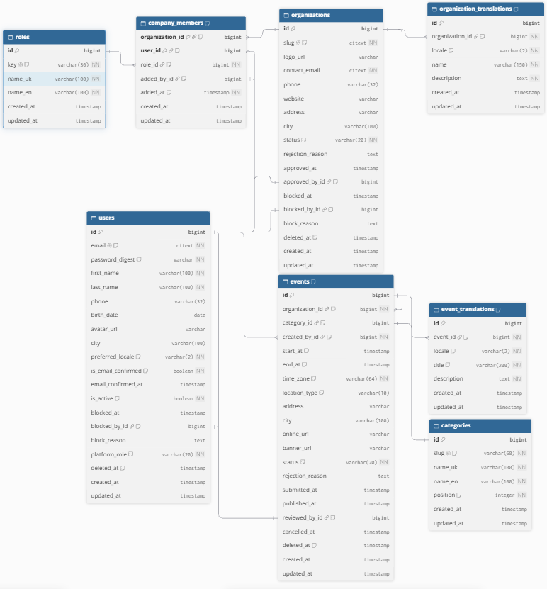

# Database Notes

This document covers database management, common commands, and troubleshooting for the **Come2Kids** project.

---

## Overview

The project uses PostgreSQL as the primary relational database.

---
## Permissions Model (Two-Layer)

Since T-1.5.4 (RBAC refactor) the platform uses two independent permission layers:

1. **Platform layer** — `users.platform_role` (`user` / `moderator`).
   Global capabilities (moderation queue, blocking, appeals) are checked
   against this column. An unauthenticated requester is a Guest.

2. **Organization layer** — `company_members` + `roles`.
   A membership row `(organization_id, user_id, role_id)` with a composite
   primary key defines what a user can do inside a specific organization.
   The `roles` reference table is seeded with `owner` (id 1) and
   `manager` (id 2); these ids are a fixed contract used by the partial
   unique indexes:
   - `idx_company_members_one_owner_per_org` — one owner per organization;
   - `idx_company_members_one_org_per_user` — one owned organization per user.

`organizations.owner_id` no longer exists: ownership is expressed by a
`company_members` row with the owner role. Assigning `owner_user` before
saving a new `Organization` automatically creates the owner membership
(`after_create` callback).

The `email_tokens` table is not part of the baseline: it will be introduced
with the registration user story (US-2.1). There is no `refresh_tokens` table:
login returns only a short-lived JWT access token (`DropRefreshTokens` migration).

---

## Database Environments

* **Development:** `come2kids_dev`
* **Test:** `come2kids_test`
* **Production:** `come2kids_production` (configured via environment variables)

---

## Common Rails Database Commands

Execute these commands from the `api/` directory.

* **Create the databases defined in `config/database.yml`:**
```bash
rails db:create
```

* **Run pending migrations:**
```bash
rails db:migrate
```


* **Populate the database with seed data:**
```bash
rails db:seed
```


* **Completely reset the database (drops, creates, migrates, and seeds):**
```bash
rails db:reset
```


* **Check the current migration status:**
```bash
rails db:migrate:status
```


* **Rollback the last migration:**
```bash
rails db:rollback
```


---

## Schema Management

The database schema is defined in `api/db/schema.rb`. This file is auto-generated by Rails and should never be edited manually. Always use migrations to alter the database structure.

### Creating a New Migration

To create a new migration, use the Rails generator:

```bash
rails generate migration AddFieldNameToTable field_name:type
```

**Example:**

```bash
rails generate migration AddEmailToUsers email:string
```
---

## Troubleshooting

### Connection Refused

Ensure the PostgreSQL service is actively running:

* **Windows:** Check Windows Services for `postgresql-x64-18`.
* **macOS:** Run `brew services start postgresql`.
* **Linux:** Run `sudo systemctl start postgresql`.

### Database Already Exists

If you encounter this error during setup, drop the existing database and recreate it:

```bash
rails db:drop
rails db:create
```

### Cannot Connect to Database

Verify your credentials in `api/config/database.yml`:

```yaml
development:
  adapter: postgresql
  database: come2kids_dev
  username: postgres
  password: YOUR_PASSWORD_HERE
  host: localhost
  port: 5432
```

## Database Documentation

### Seed Data

`rails db:seed` is idempotent (safe to run multiple times) and provides:

- reference data: roles (`owner`, `manager`) and categories (uk/en);
- fixed demo accounts: `moderator@come2kids.dev` (password from the
  `MODERATOR_PASSWORD` env variable), `owner@demo.com` / `Owner12345`,
  `user@demo.com` / `User12345`;
- a demo organization `demo-events` with two events (uk/en translations);
- Faker-generated sample organizations and events (uk locale).

### ER Diagram

**Interactive version:** [Come2Kids ER Diagram on dbdiagram.io](https://dbdiagram.io/d/Come2Kids-—-ER-Diagram-MVP-68cd7c6c960f6d821af514c6)

**Static PNG:**


> **Note:** The diagram reflects the T-1.5.4 RBAC refactor: `roles` and `company_members` tables, removed `organizations.owner_id` and the token tables.
---
