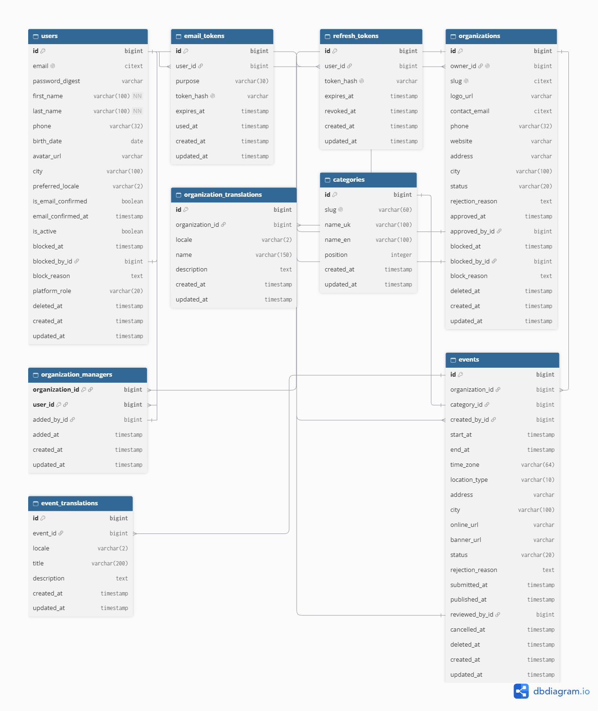

# Database Notes

This document covers database management, common commands, and troubleshooting for the **Come2Kids** project.

---

## Overview

The project uses PostgreSQL as the primary relational database.

---

## Database Environments

* **Development:** `come2kids_dev`
* **Test:** `come2kids_test`
* **Production:** `come2kids_production` (configured via environment variables)

---

## Common Rails Database Commands

Execute these commands from the `api/` directory.

**Create the databases defined in `config/database.yml`:**
  ```bash
  rails db:create
```

* **Run pending migrations:**
```bash
rails db:migrate
```


* **Populate the database with seed data:**
```bash
rails db:seed
```


* **Completely reset the database (drops, creates, migrates, and seeds):**
```bash
rails db:reset
```


* **Check the current migration status:**
```bash
rails db:migrate:status
```


* **Rollback the last migration:**
```bash
rails db:rollback
```


---

## Schema Management

The database schema is defined in `api/db/schema.rb`. This file is auto-generated by Rails and should never be edited manually. Always use migrations to alter the database structure.

### Creating a New Migration

To create a new migration, use the Rails generator:

```bash
rails generate migration AddFieldNameToTable field_name:type
```

**Example:**

```bash
rails generate migration AddEmailToUsers email:string
```
---

## Troubleshooting

### Connection Refused

Ensure the PostgreSQL service is actively running:

* **Windows:** Check Windows Services for `postgresql-x64-18`.
* **macOS:** Run `brew services start postgresql`.
* **Linux:** Run `sudo systemctl start postgresql`.

### Database Already Exists

If you encounter this error during setup, drop the existing database and recreate it:

```bash
rails db:drop
rails db:create
```

### Cannot Connect to Database

Verify your credentials in `api/config/database.yml`:

```yaml
development:
  adapter: postgresql
  database: come2kids_dev
  username: postgres
  password: YOUR_PASSWORD_HERE
  host: localhost
  port: 5432
```

## Database Documentation

### ER Diagram

**Interactive version:** [Come2Kids ER Diagram on dbdiagram.io](https://dbdiagram.io/d/Come2Kids-—-ER-Diagram-MVP-68cd7c6c960f6d821af514c6)

**Static PNG:** 

---